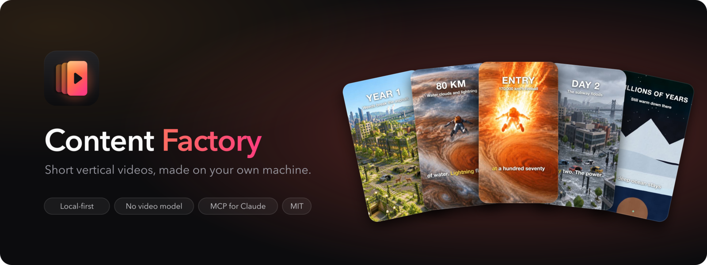
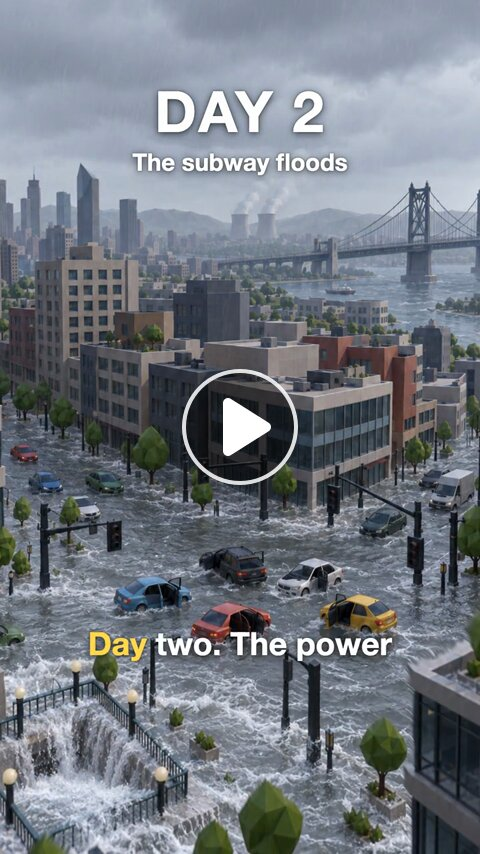
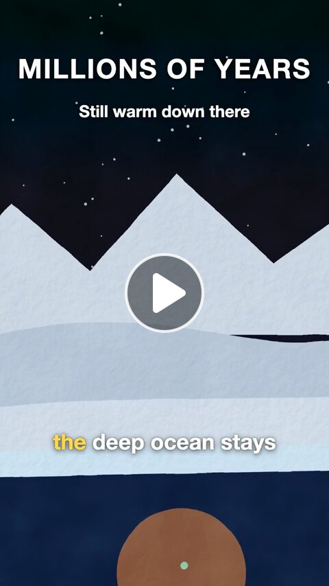
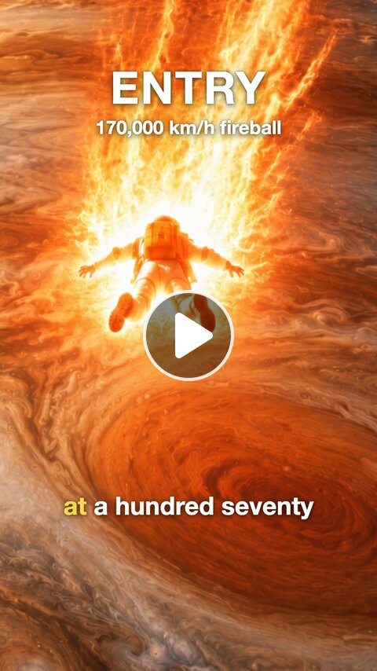
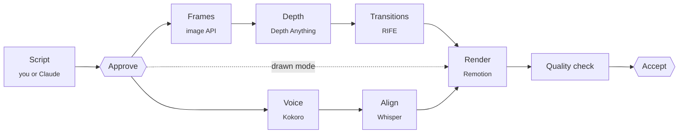

<div align="center">



# Content Factory

**Open-source AI faceless video generator for TikTok, YouTube Shorts and Instagram Reels.**<br>
A free, local alternative to Higgsfield Content Factory: write a *What if* script, or let Claude write it,<br>
and get a finished vertical video with AI frames, motion, voiceover, word-by-word subtitles and music,<br>
made on your own Mac. Free and open source: no subscription, no credits, no watermark.<br>
By [Jutsu Studio](https://jutsustudio.com/content-factory/), open-source Mac tools for AI video.

<br>

[](LICENSE)
[](#quick-start)
[](https://tauri.app)
[](https://www.remotion.dev)
[](#claude-and-mcp)
[](CONTRIBUTING.md)

[**Quick start**](#quick-start) &nbsp;·&nbsp; [How it works](#how-it-works) &nbsp;·&nbsp; [vs Higgsfield](#open-source-alternative-to-higgsfield-content-factory) &nbsp;·&nbsp; [vs MoneyPrinterTurbo](#compared-with-moneyprinterturbo-and-short-video-maker) &nbsp;·&nbsp; [Claude and MCP](#claude-and-mcp) &nbsp;·&nbsp; [FAQ](#faq) &nbsp;·&nbsp; [Architecture](docs/architecture.md) &nbsp;·&nbsp; [Contributing](CONTRIBUTING.md)

</div>

<br>

## Demo

<table>
  <tr>
    <td align="center" width="33%">
      <a href="https://github.com/jutsuhq/content-factory/releases/download/v0.1.0/what-if-every-human-vanished.mp4"></a>
    </td>
    <td align="center" width="33%">
      <a href="https://github.com/jutsuhq/content-factory/releases/download/v0.1.0/what-if-the-sun-went-out.mp4"></a>
    </td>
    <td align="center" width="33%">
      <a href="https://github.com/jutsuhq/content-factory/releases/download/v0.1.0/what-if-you-fell-into-jupiter.mp4"></a>
    </td>
  </tr>
  <tr>
    <td valign="top">
      <b>What if every human vanished today?</b><br>
      <sub>57 s · AI frames · Low-poly City<br>8 beats, a source for every fact. <a href="formats/what-if/examples/what-if-every-human-vanished.beats.json">Script</a></sub>
    </td>
    <td valign="top">
      <b>What if the Sun went out?</b><br>
      <sub>31 s · Drawn · gouache<br>Every scene is SVG code, no image generated. <a href="formats/what-if/examples/what-if-the-sun-went-out.beats.json">Script</a></sub>
    </td>
    <td valign="top">
      <b>What if you fell into Jupiter?</b><br>
      <sub>53 s · AI frames · Space Epic<br>Cuts between a wide shot and punch-ins on the diver. <a href="formats/what-if/examples/what-if-you-fell-into-jupiter.beats.json">Script</a></sub>
    </td>
  </tr>
</table>

Claude wrote each script and handed it to the engine over MCP; the scripts are in [formats/what-if/examples/](formats/what-if/examples). The engine
did the rest: frames, depth parallax, transitions, narration, word-by-word subtitles, CC0 music ducked under the voice, and a quality check.

## Why Content Factory

Faceless short-video channels run on formats: the same structure, a new topic every day. Content Factory turns a
format into a pipeline you own.

- **No video model.** Motion comes from a handful of AI stills: depth parallax, frame interpolation, layers and
  camera moves. A one-minute video needs only eight images.
- **Formats are data.** A format is a folder with a script schema, an author's guide, prompts, style presets and a
  render template; the engine, the app and the MCP server read whichever formats are there. The bundled reference
  format is *What if*: one world, one axis of change, a counter on screen and a loop back to the hook.
- **Edit one beat, rebuild one beat.** Every stage is cached by the hash of its input, so a changed line re-voices
  one beat and a new take of a frame re-renders only what depends on it.
- **A human at the gate.** You write or approve the script and accept the result. Nothing is posted for you.
- **Local first.** Voice, speech alignment, depth, interpolation and rendering run on your machine. Only image
  prompts go to the provider you picked, with your own key.
- **Agent-ready.** An MCP server lets Claude Code or any MCP client write scripts, run the pipeline and pick up the
  result, sharing one queue with the app.

## Open-source alternative to Higgsfield Content Factory

[Higgsfield Content Factory](https://higgsfield.ai/blog/higgsfield-introduces-content-factory) turns a topic into a
faceless *What if* video in the cloud. Content Factory makes the same kind of video as an open-source app you run
yourself.

| | Content Factory | Higgsfield Content Factory |
|---|---|---|
| Source code | open, MIT | closed |
| Runs on | your Mac | Higgsfield's cloud |
| Price | free: no plan, no credits, no watermark | a Higgsfield plan |
| Motion | AI stills animated by depth parallax and frame interpolation, no video model | generative video models |
| Script | you, Claude or any MCP agent, checked against the format's schema | written by the platform |
| Formats | data in a folder: add your own without touching the engine | the platform's |
| Automation | MCP server, HTTP API and a `factory` command | the web app |
| Your data | stays on your machine; only image prompts go to the provider you pick | uploaded to the service |

Content Factory is an independent project, not affiliated with or endorsed by Higgsfield AI. Higgsfield is a
trademark of its owner.

## Compared with MoneyPrinterTurbo and short-video-maker

[MoneyPrinterTurbo](https://github.com/harry0703/MoneyPrinterTurbo) and
[short-video-maker](https://github.com/gyoridavid/short-video-maker) are the best-known open-source faceless video
generators. Both cut a voiceover over background footage, mostly stock video from Pexels. Content Factory draws every
beat instead: one AI still per beat in one style, so the same place, character and camera carry through the video
and only the state of the world changes.

| | Content Factory | MoneyPrinterTurbo | short-video-maker |
|---|---|---|---|
| Visuals | an AI still per beat in one style, animated on your Mac; or SVG scenes drawn by Claude | stock footage (Pexels, Pixabay, Coverr), your own clips, or AI video and image providers | stock video from Pexels |
| Script | you or an MCP agent, checked against the format's schema | written by an LLM from a topic, or your own | your text, scene by scene |
| Voice | Kokoro (English), Vosk (Russian), on device | Edge TTS, Azure, ElevenLabs, Kokoro and others | Kokoro, English only |
| Subtitles | word by word, aligned with Whisper | yes, styled | Whisper captions |
| Formats | a folder per format (schema, guide, prompts, styles, Remotion template); agents can add one | one generic pipeline | one generic pipeline |
| Interface | Mac app, MCP server, HTTP API, `factory` CLI | web UI, API, CLI | MCP and REST server in Docker |
| Runs on | macOS, Apple silicon | Windows, macOS, Linux | Docker |
| Posting | never; you accept and export each video | can publish to TikTok, Instagram and YouTube Shorts | no |

Pick MoneyPrinterTurbo for footage-based videos on any OS, short-video-maker for an n8n or REST pipeline over stock
video, and Content Factory when the video is a story that needs its own consistent world, such as *What if*.

## What it does

- **Channels:** a project per TikTok, YouTube or Instagram account keeps its videos alike. A channel has variants
  (ready settings for one kind of video: format, style, language, voice, length, hashtags) and a cast of recurring
  characters whose looks text and reference images go with every frame, so they look the same in every video.
- **New video:** format, topic, style, language, length (within the format's limits), narration or on-screen text
  only.
- **Script editor:** the format's fields per beat (for *What if*: counter, caption, narration and image state),
  checked against its schema.
- **Frames:** six style presets or your own; another take of any frame in one click.
- **Drawn mode (prototype):** pick *Drawn* in New video and Claude draws each beat as an SVG scene, animated by data
  attributes and painted with a gouache, ink or crayon look. No image generation, so a video costs nothing.
- **Voice:** one engine per language, set in `profile.yaml`: Kokoro on MLX by default, Vosk for Russian (an optional
  component); pauses
  (`[pause 0.8]`), loudness normalised to −14 LUFS.
- **Subtitles** word by word from forced alignment.
- **Music** from a local library of CC0 tracks, ducked under the voice.
- **Quality check:** length, black frames, loudness, speech clarity, text length, music license.
- **Copies in other languages** that reuse the frames: English, Spanish, German, French, Portuguese, Russian.
- **Review and export:** copy the video file to the clipboard, show it in Finder, save accepted videos to a folder.
- **Queue** with live logs and cancel; **Storage** settings with disk usage and cache cleanup.

## Quick start

There are no signed builds yet, so build the app from source. You need macOS on Apple silicon,
[uv](https://docs.astral.sh/uv/), [Node.js](https://nodejs.org) 20+, [FFmpeg](https://ffmpeg.org) and
[Rust](https://rustup.rs).

```bash
brew install uv node ffmpeg
git clone https://github.com/jutsuhq/content-factory && cd content-factory
cd app && npm install && npx tauri build --bundles app
open "src-tauri/target/release/bundle/macos/Content Factory.app"
```

On first launch the onboarding:

1. **Installs the components:** the video renderer (Remotion, about 1 GB), RIFE for transitions, the Depth
   Anything V2 model and the starter music. FFmpeg and Node.js come with a one-line install command if missing.
2. **Asks for an image provider key** and checks it without generating anything. Drawn videos need no key, so this step can wait.
3. **Sets your defaults:** language, style, and narration or on-screen text only.

Everything can be changed later in Settings.

### Image providers

| Provider | Model |
|---|---|
| [OpenAI](https://platform.openai.com/api-keys) | GPT Image |
| [Google Gemini](https://aistudio.google.com/apikey) | Nano Banana |
| [fal.ai](https://fal.ai/dashboard/keys) | FLUX.1 Kontext |

Several providers can run at once and share the frames.

## How it works



Every script names its format; the format decides the fields, the checks and the Remotion composition that
renders it. In AI-frames mode the first frame sets the style; every other frame is an edit of it that changes only
the state of the world, so the camera holds still while the world changes. See [docs/architecture.md](docs/architecture.md) for the engine, the
format files and the job queue.

### From the command line

The engine is the Python project in `engine/`; run these there.

```bash
cd engine
uv sync                                    # add --extra vosk for the Russian voice
uv run factory doctor                      # detect the machine, write profile.yaml
uv run factory setup all                   # renderer, RIFE, depth model, music
uv run factory catalog format              # formats and how to write a script in one
uv run factory create "<topic>" --script beats.json
uv run factory create "<topic>" --project <id> --variant <id> --cast milo,biscuit
uv run factory run <slug> approve          # make the video, wait for the job
uv run factory run <slug> rebuild --stages render
uv run factory accept <slug>
```

The command line is a client of the engine's API, like the app and the MCP server: the same commands as the MCP
tools, one shared job queue. `uv run factory --help` lists them all.

## Claude and MCP

Content Factory is an MCP server for the whole AI video pipeline, from script to rendered video. `factory mcp` is an MCP server over stdio. It talks to the running engine (and starts it if needed), so the app and
the agent see the same queue. The factory never writes scripts itself: the agent lists the formats and reads one's
rules with `catalog('format')`, writes the script and passes it to `create` with the format id.

```bash
claude mcp add -s user content-factory -- uv run --project /path/to/content-factory/engine factory mcp
```

Tools: `status`, `episodes`, `episode`, `create`, `edit_script`, `run` (approve, rebuild, redo a frame, translate),
`job`, `accept`, `catalog` (format, new_format, styles, music, voices, projects), `format_source`, `save_format`. Then ask Claude something like *"make a What if
video about falling into Jupiter, 70 seconds, space epic style"*, or *"two new videos for Tiny Town Tales, English
variant, with Milo"*: `catalog('projects')` gives the channel's brief, variants and cast. When no format fits, Claude
can bring a new one: it reads the closest format with `format_source`, writes its own (schema, guide, prompts,
styles, Remotion template, an example) and `save_format` checks and adds it, ready in the app at once
([formats/README.md](formats/README.md)).

The [`make-video`](skills/make-video/SKILL.md) skill walks Claude Code through a whole video: the idea test, the
script rules, the checks on the result and a checklist before posting. Copy or link `skills/make-video` into
`~/.claude/skills/`. The reasoning behind it, from picking an idea to staying original on a channel, is in
[docs/playbook.md](docs/playbook.md).

## Repository layout

Each top-level folder is a module with its own README, so a change usually stays inside one of them.

| Folder | What it is | Stack |
|---|---|---|
| [`engine/`](engine) | the engine: pipeline stages, job queue, HTTP API, MCP server, `factory` command | Python, uv |
| [`formats/`](formats) | video formats as data: schema, guide, prompts, styles, render template, example scripts | YAML, JSON, React |
| [`render/`](render) | the Remotion project that renders any format's template | Node, Remotion |
| [`app/`](app) | the desktop app that drives the engine | Tauri, React |
| [`docs/`](docs) | architecture notes, the [playbook](docs/playbook.md) and README images | |
| [`skills/`](skills) | a Claude Code skill for making videos with the MCP server | |

Everything the engine writes in a checkout goes to `data/`, which git ignores.

## Privacy

- No backend, no account, no telemetry. The engine listens on `127.0.0.1` only.
- Image prompts and the reference frame go to the image provider you chose, with your key. Nothing else leaves your
  machine.
- API keys live in the app's data folder (`.env`, owner-only permissions).
- Found a vulnerability? Report it privately as described in [SECURITY.md](SECURITY.md).

## Status

Early. macOS on Apple silicon is the tested platform. Windows and Linux builds are planned: the engine avoids shell
scripts and platform-only tools, but the voice back end there is not finished yet.

## Credits

- [Remotion](https://www.remotion.dev) renders the video. It is installed on your machine by the setup step and has
  its own license, which may require a company license for some teams.
- [Depth Anything V2](https://github.com/DepthAnything/Depth-Anything-V2) small (Apache-2.0), via
  [onnx-community](https://huggingface.co/onnx-community/depth-anything-v2-small).
- [RIFE ncnn Vulkan](https://github.com/nihui/rife-ncnn-vulkan) (MIT) for frame interpolation.
- [Kokoro](https://huggingface.co/hexgrad/Kokoro-82M) (Apache-2.0) via [MLX-Audio](https://github.com/Blaizzy/mlx-audio).
- Music: CC0 tracks from [OpenGameArt](https://opengameart.org), downloaded at setup.

## FAQ

**What is Content Factory?**
An open-source desktop app and engine that turns a script into a finished faceless short video for TikTok, YouTube
Shorts and Instagram Reels: AI frames, parallax motion, transitions, voiceover, subtitles, music and a quality check.

**Is it free?**
Yes. Content Factory is free and open source under the MIT license, with no subscription, credits or watermark.
Drawn videos need nothing else; AI-frames videos draw their images with your own OpenAI, Gemini or fal.ai key.

**Is it a Higgsfield alternative?**
Yes, for faceless *What if* videos: the same format, made locally and open source. It does not generate video with
a video model; motion comes from stills.

**Does it write the script for me?**
No. You write it in the app, or Claude (or any MCP client) writes it through the MCP server. The engine checks it,
voices it and renders it.

**Which platforms does it run on?**
macOS on Apple silicon today. The engine avoids platform-only tools; Windows and Linux are planned.

**Which languages can it narrate?**
English out of the box with Kokoro, Russian with the optional Vosk voice; other languages take a voice set in
`profile.yaml`. Scripts and on-screen text can be English, Spanish, German, French, Portuguese or Russian, and a video
can be copied into another language that reuses its frames.

**Can I add my own video format?**
Yes. A format is a folder in [`formats/`](formats) with a schema, a guide, prompts, styles and a Remotion template;
see [formats/README.md](formats/README.md).

## Related

Other open-source projects from [Jutsu Studio](https://jutsustudio.com/):

- [Jutsu Studio](https://github.com/jutsuhq/jutsu-studio): the open-source Higgsfield desktop app for Mac · [jutsustudio.com](https://jutsustudio.com/)
- [Swapjutsu](https://github.com/jutsuhq/swapjutsu-seedance-character-swap): free character swap for Mac, no watermark · [jutsustudio.com/swapjutsu](https://jutsustudio.com/swapjutsu/)
- [Kawarimi](https://github.com/jutsuhq/kawarimi-local-character-swap): free local AI character swap for Windows and Linux, no cloud · [jutsustudio.com/kawarimi](https://jutsustudio.com/kawarimi/)
- [EdgeTAM Core ML](https://github.com/jutsuhq/edgetam-coreml): EdgeTAM video object tracking in Core ML, on the Apple Neural Engine
- [edgetam-onnx](https://github.com/jutsuhq/edgetam-onnx): the same tracker in Rust on ONNX Runtime CUDA, for Windows and Linux
- [Higgsfield Gateway](https://github.com/jutsuhq/higgsfield-gateway): a budget-capped Higgsfield API gateway on Cloudflare Workers · [jutsustudio.com/blog/higgsfield-api-production](https://jutsustudio.com/blog/higgsfield-api-production/)
- [Seedance 2.5 Prompt Skill](https://github.com/jutsuhq/higgsfield-seedance-prompt-skill): a Claude skill that writes Seedance 2.5 prompts for Higgsfield · [jutsustudio.com/blog/seedance-prompt-skill](https://jutsustudio.com/blog/seedance-prompt-skill/)
- [AI video API prices](https://github.com/jutsuhq/video-api-prices): what one second of AI video costs at 30+ providers, updated daily · [jutsustudio.com/video-api-pricing](https://jutsustudio.com/video-api-pricing/)
- [Open Source Higgsfield](https://github.com/jutsuhq/open-source-higgsfield): every #OpenSourceHiggsfield challenge project, by category · [jutsustudio.com/open-source-higgsfield](https://jutsustudio.com/open-source-higgsfield/)
- [awesome-higgsfield](https://github.com/jutsuhq/awesome-higgsfield): tools, SDKs, agent skills and apps for Higgsfield

## License

[MIT](LICENSE) © Content Factory contributors

<div align="center">
<br>

<br>
<sub>Made for people who would rather tell the story than edit the timeline.</sub>
</div>
